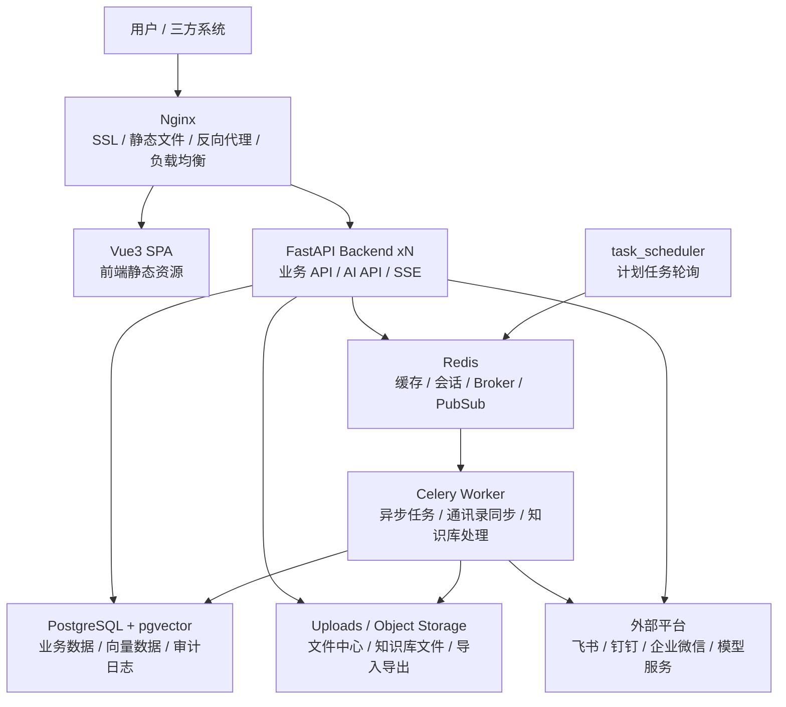

# 若茗 PaaS

> **企业级 AI 应用开发底座** | Enterprise-grade AI PaaS Framework


**Author**: ruoming  
**Demo**: [http://paas.airuoming.top/](http://paas.airuoming.top/)  
**Version**: v2.3.0  
**技术栈**: FastAPI + Vue3 + PostgreSQL + Redis + pgvector

---

## 产品定位

若茗 PaaS 是一套面向专业开发者的企业级 AI 应用开发底座。

**一句话定位**：企业级底座 + 原生 AI 能力，开发者只写业务代码。

它不是单纯的后台管理模板，而是把企业应用开发中反复出现的账号、权限、租户、配置、审计、文件、集成、消息、计划任务和 AI 能力沉淀为底座。开发者在此基础上新增业务模块，接入菜单权限和 API，即可形成可交付的企业应用。

### 适合场景

- 快速搭建企业内部管理系统、SaaS 平台或 AI 应用控制台。
- 在已有组织、权限、配置、审计和多租户能力上扩展业务模块。
- 统一接入飞书、钉钉、企业微信等外部系统。
- 构建带模型管理、Agent、知识库、Prompt 模板的 AI 应用。
- 作为项目脚手架和交付底座，减少重复基础设施开发。

| 对比维度 | 若茗 PaaS | Dify | RuoYi |
|---------|-----------|------|-------|
| AI + 企业底座 | ✅ 二合一原生集成 | AI 无企业底座 | 企业底座无 AI |
| 多租户 | ✅ 行级隔离，自动注入 | 工作区 | ❌ |
| 权限粒度 | ✅ 细粒度到按钮/列级 | 基础 | 菜单级 |
| 技术栈 | FastAPI + Vue3 | Python + React | Spring Boot |

---

## 当前文档入口

| 文档 | 说明 |
|------|------|
| [用户手册](./docs/用户手册.md) | 开发底座使用说明：启动服务、开发模块、接入权限菜单、了解内置基础功能 |
| [当前功能清单](./docs/当前功能清单.md) | 基于当前代码和初始化菜单整理的功能索引 |
| [文档首页](./docs/README.md) | 架构、开发、部署、规范和路线图导航 |
| [系统架构图](./docs/architecture.html) | 可视化架构图，适合评审、演示和截图 |
| [架构总览](./docs/01_架构总览.md) | Mermaid 架构图、技术选型、模块分层和设计原则 |
| [快速启动](./docs/01_快速启动.md) | 开发环境启动、服务地址、常见问题 |

平台内也已集成用户手册入口：`帮助中心 / 用户手册`，路由为 `/help/manual`。

---

## 快速启动

### 前置条件

- Docker & Docker Compose（推荐）
- （可选本地开发）Python 3.11+、Node.js 20+

### 一键启动（推荐）

```bash
# 1. 克隆项目
git clone https://github.com/ruoming/ruoming-paas.git
cd ruoming-paas

# 2. 复制环境变量
cp backend/.env.example backend/.env.development
# 根据需要编辑 backend/.env.development（至少确认 SECRET_KEY）

# 3. 一键启动（自动检测首次初始化，完成数据库初始化）
bash scripts/start.sh dev
```

启动成功后访问：

| 服务 | 地址 |
|------|------|
| **前端管理台** | http://localhost:3000 |
| **后端 API** | http://localhost:8000 |
| **API 文档** | http://localhost:8000/api/docs |
| **健康检查** | http://localhost:8000/api/health |

### 默认账号

| 账号 | 密码 | 角色 |
|------|------|------|
| `admin` | `ruoming@2024` | 平台超级管理员 |

> ⚠️ **首次登录后请立即修改密码**

### 脚本命令

```bash
bash scripts/start.sh dev       # 启动开发环境
bash scripts/start.sh stop      # 停止开发环境
bash scripts/start.sh status    # 查看服务状态
bash scripts/start.sh logs      # 查看所有日志
bash scripts/start.sh logs backend   # 查看后端日志
bash scripts/start.sh logs frontend  # 查看前端日志
```

---

## 开发者最短路径

### 1. 启动底座

```bash
cp backend/.env.example backend/.env.development
bash scripts/start.sh dev
```

首次启动会自动初始化系统菜单、角色、权限、字典和默认管理员。更新代码后如果看不到新菜单，可手动补齐：

```bash
cd deploy
docker compose exec backend python /app/scripts/init_data.py
```

### 2. 新增业务模块

推荐按“后端模块 → 数据迁移 → 前端接口 → 前端页面 → 菜单权限 → 联调验证”的顺序开发。

| 步骤 | 位置 | 说明 |
|------|------|------|
| 后端模型 | `backend/app/modules/<module>/models.py` | 定义 ORM 模型，按需继承基础字段、租户字段和软删除能力 |
| Schema | `backend/app/modules/<module>/schemas.py` | 定义请求和响应结构 |
| Service | `backend/app/modules/<module>/service.py` | 编写业务逻辑，避免把复杂逻辑塞进 Router |
| Router | `backend/app/modules/<module>/router.py` | 暴露 `/api/v1/` 前缀下的接口 |
| 迁移 | `backend/migrations/versions/` | 通过 Alembic 管理数据库结构变更 |
| 前端 API | `frontend/src/api/` | 统一封装请求，页面直接消费业务响应对象 |
| 前端页面 | `frontend/src/views/` | 使用 Vue3、TypeScript、Element Plus 实现页面 |
| 菜单权限 | `backend/scripts/init_data.py` 或菜单管理页面 | 接入菜单、按钮和列权限 |

详细步骤见：[如何添加业务模块](./docs/如何添加业务模块.md)。

### 3. 接入菜单和权限

菜单由后端 `sys_permission` 数据驱动，登录后前端按权限动态注册路由。

- `perm_type=menu`：控制页面是否出现在侧边栏。
- `perm_type=button`：控制新增、编辑、删除、导出等操作。
- `perm_type=column`：控制手机号、邮箱、密钥等敏感字段是否展示。
- `component=system/user/index` 对应 `frontend/src/views/system/user/index.vue`。

新增内置菜单时，建议写入 `backend/scripts/init_data.py`，保证新环境和已有环境重复执行初始化脚本都能补齐。

### 4. 开发验证

```bash
# 后端脚本语法检查
PYENV_VERSION=3.11.7 python -m py_compile backend/scripts/init_data.py

# 前端类型检查
cd frontend && npm run type-check

# Git 空白和换行检查
git diff --check
```

如果修改了数据库结构：

```bash
cd backend
alembic revision --autogenerate -m "describe change"
alembic upgrade head
```

---

## 本地开发（不用 Docker）

### 后端

```bash
cd backend

# 创建虚拟环境
python -m venv .venv
source .venv/bin/activate   # Windows: .venv\Scripts\activate

# 安装依赖（uv 加速）
pip install uv
uv pip install -e ".[dev]"

# 启动基础设施（PostgreSQL + Redis）
cd ../deploy && docker compose up -d postgres redis

# 数据库迁移
cd ../backend
APP_ENV=development alembic upgrade head

# 初始化种子数据（首次必须）
python scripts/init_data.py

# 启动开发服务器（热重载）
uvicorn app.main:app --reload --host 0.0.0.0 --port 8000
```

### 前端

```bash
cd frontend

# 安装依赖
npm install

# 启动开发服务器（热重载，代理到 localhost:8000）
npm run dev
# 访问 http://localhost:3000

# 构建生产版本
npm run build
# 产物在 dist/ 目录
```

---

## 生产部署

### 准备工作

```bash
# 1. 配置生产环境变量
cp deploy/.env.production.example deploy/.env.production
vi deploy/.env.production

# 2. 配置 SSL 证书（可选，Let's Encrypt 或商业证书）
mkdir -p deploy/nginx/ssl
cp /path/to/fullchain.pem deploy/nginx/ssl/
cp /path/to/privkey.pem   deploy/nginx/ssl/

# 3. 修改域名（deploy/nginx/nginx.prod.conf 中的 server_name，可选）
```

### 启动生产环境

```bash
bash scripts/start.sh prod
# 等价于：
# cd deploy && docker compose --env-file .env.production -f docker-compose.prod.yml up -d
```

### 生产环境架构



---

## 项目结构

```
RuoMingPaas/
├── backend/                    # FastAPI 后端
│   ├── app/
│   │   ├── main.py             # 应用入口
│   │   ├── config.py           # 全局配置（Pydantic Settings）
│   │   ├── database.py         # 数据库连接
│   │   ├── core/               # 核心基础设施
│   │   │   ├── security.py     # JWT、密码哈希、AES 加密
│   │   │   ├── deps.py         # 依赖注入（认证、权限）
│   │   │   ├── exceptions.py   # 类型化异常体系
│   │   │   ├── response.py     # 统一响应格式
│   │   │   ├── base_model.py   # ORM 基类
│   │   │   ├── base_repository.py  # 多租户感知 Repository
│   │   │   └── middleware/     # 中间件（RequestID/日志/租户）
│   │   ├── modules/            # 业务模块
│   │   │   ├── auth/           # 认证（JWT、Refresh Token、API Key）
│   │   │   ├── user/           # 用户管理、外部联系人同步
│   │   │   ├── permission/     # RBAC 权限（角色继承、菜单/按钮/列）
│   │   │   ├── tenant/         # 多租户（配额、套餐）
│   │   │   ├── audit/          # 审计日志
│   │   │   ├── config_center/  # 配置中心（四级分层、缓存、历史）
│   │   │   ├── integration/    # 飞书/钉钉/企业微信/自定义集成
│   │   │   ├── file_center/    # 文件中心
│   │   │   ├── message/        # 公告和站内消息
│   │   │   ├── monitor/        # 服务监控、计划任务
│   │   │   └── codegen/        # 代码生成
│   │   └── ai/                 # AI 能力模块
│   │       ├── llm/            # LLM 网关（多供应商路由）
│   │       ├── agent/          # Agent 编排
│   │       ├── knowledge/      # 知识库 RAG（pgvector）
│   │       └── prompt/         # Prompt 版本管理
│   ├── Dockerfile              # 多阶段构建
│   ├── migrations/             # Alembic 数据库迁移
│   ├── scripts/                # 运维脚本（init_data.py 等）
│   └── tests/                  # 测试（pytest）
├── frontend/                   # Vue3 管理后台
│   ├── src/
│   │   ├── main.ts             # 应用入口
│   │   ├── App.vue
│   │   ├── api/                # 按模块分层 API（auth/user/ai 等）
│   │   ├── store/              # Pinia（auth/permission/app）
│   │   ├── router/             # 动态路由 + 导航守卫
│   │   ├── layouts/            # 主布局（侧边栏+标签页+Header）
│   │   ├── directives/         # v-permission 权限指令
│   │   ├── utils/              # request.ts（Axios+Token刷新）
│   │   └── views/              # 页面
│   │       ├── login/          # 登录页
│   │       ├── dashboard/      # 工作台、首页模板、常用入口
│   │       ├── help/           # 帮助中心、用户手册
│   │       ├── system/         # 用户、部门、租户、配置、字典、文件、集成
│   │       ├── message/        # 公告、我的消息
│   │       ├── monitor/        # 服务监控、计划任务
│   │       ├── dev/            # 代码生成
│   │       ├── ai/             # AI 管理
│   │       │   ├── model/      # 模型管理（多供应商+连通测试）
│   │       │   ├── agent/      # Agent管理（卡片式）
│   │       │   ├── knowledge/  # 知识库（文档上传+检索测试）
│   │       │   ├── conversation/ # 对话历史（Markdown渲染）
│   │       │   └── prompt/     # Prompt模板（版本管理+预览）
│   │       └── audit/          # 审计
│   │           ├── logs/       # 操作审计（before/after对比）
│   │           └── login/      # 登录日志
│   ├── Dockerfile              # 多阶段构建（Node构建 + Nginx托管）
│   └── vite.config.ts
├── deploy/                     # 部署配置
│   ├── docker-compose.yml      # 本地开发（Vite Dev Server）
│   ├── docker-compose.prod.yml # 生产部署（Nginx + 双后端实例）
│   ├── nginx/
│   │   └── nginx.prod.conf     # Nginx 生产配置（SSE/SSL/缓存/限流）
│   └── init-db.sql             # 数据库初始化 SQL
├── scripts/
│   └── start.sh                # 一键启动脚本
└── docs/                       # 文档、用户手册、当前功能清单
```

---

## 平台内置基础能力

| 能力 | 菜单入口 | 开发价值 |
|------|----------|----------|
| 工作台 | 工作台 | 首页模板、常用入口、消息公告和系统摘要 |
| 组织账号 | 系统管理 / 用户、部门、租户 | 用户、部门、租户和外部联系人同步 |
| 权限中心 | 权限中心 / 角色、菜单、授权 | 菜单、按钮、列权限和数据范围控制 |
| 配置中心 | 平台配置 / 配置中心 | 运行时配置、加密脱敏、导入导出、历史和缓存 |
| 字典管理 | 平台配置 / 字典管理 | 状态、类型、枚举值等基础数据 |
| 文件中心 | 资源与集成 / 文件中心 | 上传、预览、下载、归档和删除 |
| 集成中心 | 资源与集成 / 集成中心 | 飞书、钉钉、企业微信、自定义连接 |
| AI 管理 | AI 管理 | 模型、Agent、知识库、Prompt、工具和对话 |
| 消息中心 | 消息中心 | 平台公告、站内消息和未读提醒 |
| 审计日志 | 审计日志 | 操作日志、登录日志和问题追踪 |
| 开发工具 | 开发工具 / 代码生成 | 业务模块代码预览和写入 |
| 系统监控 | 系统监控 / 服务监控、计划任务 | 服务状态、定时任务和执行日志 |

---

## 技术特性

### 后端

| 特性 | 实现方式 |
|------|---------|
| **多租户行级隔离** | Repository 基类自动注入 `tenant_id`，无需手写 WHERE |
| **JWT + Refresh Token** | Access Token 15min，Refresh Token 7天，自动续期 |
| **RBAC 细粒度权限** | 菜单权限 + 按钮权限 + 列权限，前端 v-permission 指令配合 |
| **AI 模型网关** | 模型配置、OpenAI 兼容协议、默认模型、熔断和回退 |
| **RAG 知识库** | pgvector 向量存储，支持文档分片、重建索引和多来源接入 |
| **审计日志** | 自动记录 before/after 数据快照，追踪所有写操作 |
| **配置中心** | 全局 → 租户 → 应用 → 用户，下层覆盖上层，支持加密脱敏、历史和缓存清理 |
| **集成与同步** | 飞书、钉钉、企业微信连接管理，支持外部联系人同步、自检、预览和计划任务 |
| **计划任务** | 独立调度服务，支持 interval 和 Cron，执行日志可追踪 |

### 前端

| 特性 | 实现方式 |
|------|---------|
| **动态路由** | 登录后按后端菜单权限动态注册路由，超管全部可见 |
| **Token 自动刷新** | Axios 拦截器队列，并发请求只刷新一次 |
| **v-permission 指令** | `<el-button v-permission="'user:create'">` 无权限 DOM 移除 |
| **多标签页** | TabsBar 支持关闭/关闭其他/关闭全部，affix 固定 |
| **暗色模式** | VueUse `useDark`，CSS 变量注入 |
| **Markdown 渲染** | 对话历史用 markdown-it 渲染 AI 回复 |

---

## API 接口

| 模块 | 接口前缀 |
|------|---------|
| 认证 | `POST /api/v1/auth/login` |
| 用户管理 | `/api/v1/users/` |
| 权限/角色/菜单 | `/api/v1/permissions/` |
| 租户管理 | `/api/v1/tenants/` |
| 配置中心 | `/api/v1/config-center/` |
| 文件中心 | `/api/v1/files/` |
| 集成中心 | `/api/v1/integrations/` |
| 消息中心 | `/api/v1/messages/`、`/api/v1/notices/` |
| 系统监控/计划任务 | `/api/v1/monitor/` |
| AI 模型 | `/api/v1/ai/models/` |
| Agent | `/api/v1/ai/agents/` |
| 知识库 | `/api/v1/ai/knowledge/` |
| 对话 | `/api/v1/ai/conversations/` |
| 审计日志 | `/api/v1/audit/` |
| API 文档 | `/api/docs` |
| 健康检查 | `/api/health` |

`/api/docs` 和 `/api/redoc` 仅在非生产环境开放，生产环境默认关闭。

---

## 版本里程碑

| 版本 | 状态 | 内容 |
|------|------|------|
| v1.0（文档期） | ✅ 完成 | 21 份设计文档 |
| v2.0（MVP） | ✅ 完成 | 后端核心模块 + Vue3 管理台 + Docker 一键部署 |
| v2.3（当前） | ✅ 进行中 | 配置中心、文件中心、消息中心、集成中心、外部联系人同步、计划任务、用户手册 |
| v3.0（强化） | ⬜ 计划中 | 更完整的测试覆盖、示例业务模块、运维监控增强 |
| v4.0（生态版） | ⬜ 计划中 | 插件市场、云托管、商业化扩展 |

---

## 常见问题

### 启动后前端打不开

先确认服务状态和后端健康检查：

```bash
bash scripts/start.sh status
curl http://localhost:8000/api/health
```

如果后端未启动，查看日志：

```bash
bash scripts/start.sh logs backend
```

### 看不到新增菜单

菜单数据来自后端权限表。新增内置菜单后执行：

```bash
cd deploy
docker compose exec backend python /app/scripts/init_data.py
```

然后重新登录。

### 前端依赖异常或 `node_modules` 损坏

开发 Compose 已给 `/app/node_modules` 使用独立 volume。宿主机本地开发时可重新安装：

```bash
cd frontend
npm ci
```

### `npm run type-check` 失败

先确认依赖已安装：

```bash
cd frontend
npm ci
npm run type-check
```

如果失败信息来自既有页面，按错误文件逐个修复；不要用关闭类型检查的方式绕过。

### AI 或 Agent 不可用

先进入 `AI 管理 / 模型管理` 配置模型并验证连通，再创建或绑定 Agent。Agent 初始化依赖模型配置。

### 通讯录同步失败

先在 `资源与集成 / 集成中心` 测试连接，再到用户管理里执行同步自检和预览。飞书、钉钉、企业微信需要分别配置对应应用凭证和通讯录权限。

---

## 开发规范

- **后端**：Python 3.11+，`ruff` 格式化，所有函数必须有类型注解
- **前端**：Vue3 + TypeScript，ESLint + Prettier，组合式 API（`<script setup>`）
- **Commit**：遵循 Conventional Commits（`feat:` / `fix:` / `docs:` ...）
- **数据库变更**：必须通过 `alembic revision --autogenerate` 生成迁移文件
- **测试覆盖率**：核心模块 API 层目标 ≥ 80%

---

## 贡献指南

### 开发流程

1. **Fork 仓库** → 创建个人分支
2. **分支命名**：`feature/xxx`（新功能）、`fix/xxx`（修复）、`docs/xxx`（文档）
3. **提交规范**：遵循 [Conventional Commits](https://www.conventionalcommits.org/)
   ```
   feat(auth): 添加多因素认证
   fix(config): 修复配置中心缓存失效问题
   docs(tenant): 更新多租户文档
   ```
4. **代码检查**：提交前运行本地检查
   ```bash
   # 后端
   cd backend && python -m ruff check .
   
   # 前端
   cd frontend && npm run lint
   ```
5. **创建 PR** → 等待审核和合并

### 分支策略

| 分支 | 用途 | 保护状态 |
|------|------|----------|
| `main` | 生产环境，稳定版本 | ✅ 受保护 |
| `develop` | 开发分支，集成功能 | ✅ 受保护 |
| `feature/xxx` | 功能开发分支 | - |
| `fix/xxx` | Bug 修复分支 | - |
| `release/xxx` | 版本发布分支 | - |

### 代码规范

- **后端**：Python 3.11+，使用 `ruff` 进行代码检查和格式化
- **前端**：Vue3 + TypeScript，使用 ESLint + Prettier
- **数据库**：必须通过 Alembic 迁移，禁止直接修改数据库
- **测试**：核心模块需编写单元测试，目标覆盖率 ≥ 80%

### 问题反馈

欢迎通过 GitHub Issues 提交问题和建议：

1. **Bug 报告**：描述问题现象、复现步骤、预期结果
2. **功能请求**：描述需求背景和期望行为
3. **文档改进**：指出文档中的错误或需要补充的内容

---

## 许可证

MIT License - 详见 [LICENSE](./LICENSE)

*© 2026 ruoming. All rights reserved.*
