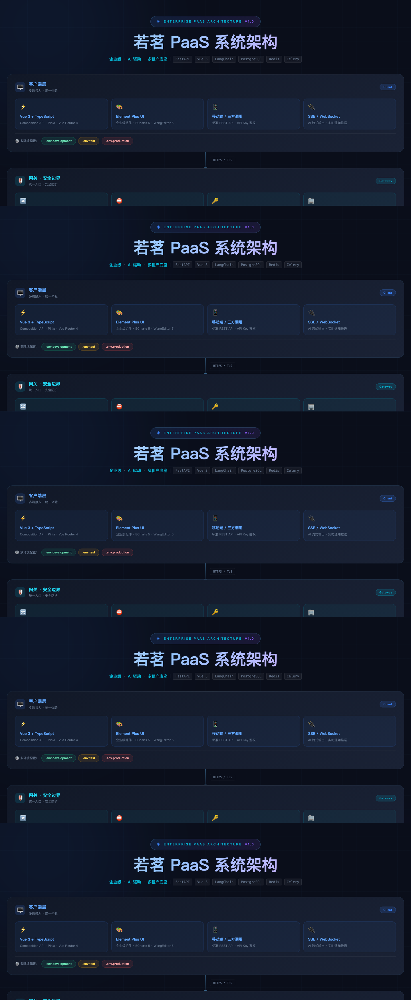
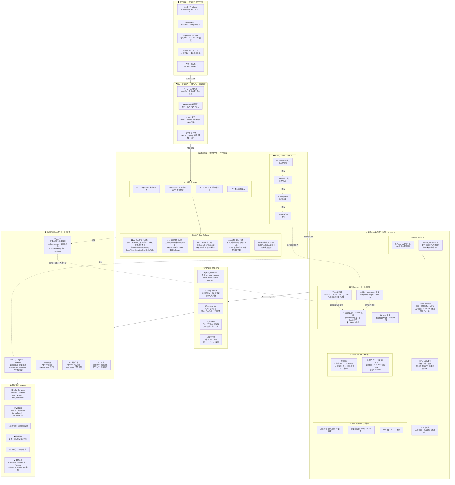

# 01 架构总览

> **阅读对象**：想深入了解若茗底座架构设计的开发者。  
> 如果你是第一次接触若茗，建议先读 [00_产品介绍.md](./00_产品介绍.md) 和 [02_核心概念.md](./02_核心概念.md)。



## 1. 项目定位

若茗 PaaS 是一套**面向开发者的企业级 AI 应用开发底座**。

**定位**：帮助开发团队跳过重复造基础设施的阶段，直接在一个生产可用的底座上开发业务功能。

**核心目标**：
- 企业级底座与原生 AI 能力二合一（市面上极少有同时做好两件事的框架）
- 模块化设计，L0-L4 分层，按需启用，新模块插件式接入
- 约定优于配置：遵守规范，底层能力（租户隔离、审计、限流）自动生效
- 生产可用而非玩具：每个设计决策都考虑了生产环境的安全性和稳定性

---

## 2. 技术选型

### 2.1 后端

| 层次 | 技术 | 版本 | 说明 |
|------|------|------|------|
| Web 框架 | FastAPI | ≥ 0.110 | 异步、自动 OpenAPI |
| 数据库 ORM | SQLAlchemy 2.x + Alembic | ≥ 2.0 | 异步 ORM，迁移管理 |
| 主数据库 | PostgreSQL + pgvector | ≥ 16 | 见下方详细说明 |
| 缓存 / 消息 | Redis | ≥ 7.0 | 见下方详细说明 |
| 向量存储 | PostgreSQL + pgvector | — | 知识库向量检索，减少额外运维组件 |
| 任务队列 | Celery + Redis Broker | — | 异步任务、计划任务、知识库处理、外部联系人同步 |
| 认证 | JWT (**PyJWT**) | ≥ 2.8 | Access + Refresh Token，Rotation 轮换策略 |
| 数据验证 | Pydantic v2 | ≥ 2.0 | 请求/响应模型 |
| 日志 | **structlog**（主）+ Loguru（文件 sink） | — | 结构化 JSON 日志，单一数据流 |
| 链路追踪 | OpenTelemetry | — | Trace/Span 注入 |
| AI SDK | LangChain（内部封装，不对外暴露） | ≥ 0.2 | Agent 编排底层 |
| 大模型接入 | **多协议统一 LLM 网关** | — | 追鹿 API + OpenAI 兼容层 + **Anthropic 原生** + **Gemini 原生**，多模型热插拔 |
| LLM 熔断器 | **三状态熔断器**（自研） | — | CLOSED→OPEN→HALF_OPEN，主力模型故障自动切换备用模型 |
| LLM 语义缓存 | Redis Hash 缓存（自研） | — | hash(model+messages) 做 key，temperature=0 时命中跳过 LLM 调用 |
| 文件存储 | MinIO / 阿里云 OSS | — | 对象存储（含签名下载权限） |
| 限流 | slowapi + Redis | — | 按用户/租户/IP/接口多维限流，AI Token 配额熔断 |
| 敏感脱敏 | 自研 sensitive_mask | — | 日志/接口响应自动脱敏（手机号、邮箱、身份证、Token） |
| 全文检索 | PostgreSQL FTS（内置）/ Elasticsearch（可选） | — | 知识库 BM25 检索，ES 可选接入 |

---

### 2.2 数据库选型说明

#### 主数据库：PostgreSQL 16 + pgvector

选择 PostgreSQL 而非 MySQL，核心原因如下：

| 能力 | PostgreSQL | MySQL | 对若茗的意义 |
|------|-----------|-------|------------|
| **JSONB 原生支持** | ✅ 可索引、可查询 | ⚠️ JSON 支持弱 | 配置中心四级覆盖值、审计日志变更快照直接存 JSONB，无需额外序列化 |
| **行级安全（RLS）** | ✅ 原生支持 | ❌ 不支持 | 多租户数据隔离的最后一道兜底防线，应用层出 bug 时数据库层防止越权 |
| **pgvector 插件** | ✅ 直接安装 | ❌ 不支持 | MVP 阶段向量检索不需要单独部署 Milvus/Qdrant，减少基础设施复杂度 |
| **全文检索（FTS）** | ✅ 内置 `tsvector`，中文分词可扩展 | ⚠️ 较弱 | BM25 检索直接用 PG 内置，无需引入 ES |
| **窗口函数 / CTE** | ✅ 完整支持 | ⚠️ 部分支持 | 审计日志查询、报表 BI、分页统计场景必备 |
| **事务完整性** | ✅ MVCC 成熟，写并发强 | ⚠️ 有差距 | 多租户高并发写入场景更可靠 |
| **扩展生态** | pgvector、TimescaleDB、PostGIS… | 极少 | 未来时序数据、地理信息等场景可无缝扩展 |

> **为什么不用 MySQL**：MySQL 不支持 RLS（多租户兜底防护失效）、不支持 pgvector（必须额外部署向量库）、JSONB 能力弱（配置中心和审计日志设计受限）。三个核心缺口对若茗 PaaS 而言不可接受。

#### 缓存层：Redis 7+

Redis 在若茗中承担多个角色，选择 Redis 7+ 原因：

| 使用场景 | Key 模式 / 说明 |
|---------|------|
| **会话缓存** | JWT Refresh Token 存储与黑名单（Token 撤销） |
| **接口限流** | slowapi 依赖 Redis 计数器，支持滑动窗口算法 |
| **任务队列** | Celery Broker / Result Backend，承载异步任务分发与结果存储 |
| **Pub/Sub** | 事件总线跨进程事件广播，WebSocket 多实例消息同步，配置缓存失效广播，**LLM Provider 多进程缓存失效** |
| **分布式锁** | 防止计划任务重复执行、并发导入冲突 |
| **热点数据缓存** | 权限树、字典数据、`config:merged:*` 合并配置等高频读取数据 |
| **AI Token 配额** | 实时累计每租户的 LLM Token 消耗，超配额立即熔断 |
| **LLM 熔断器状态** | `llm:circuit:{id}:state` / `fail_count` / `open_at`，三状态机持久化 |
| **LLM 语义缓存** | `llm:semantic_cache:{sha256}`，temperature=0 请求命中时跳过 LLM 调用 |
| **LLM Embedding 缓存** | `llm:embed_cache:{sha256}`，相同文本不重复向量化 |

> **Redis 7+ 的关键新特性**：Multi-Part AOF（持久化可靠性提升）、ACL 细粒度权限控制（多租户环境更安全）、Functions（替代部分 Lua 脚本场景）。

#### 向量数据库：分阶段策略

若茗对向量数据库采用**分阶段演进**策略，而非一开始就引入重型向量库：

```
MVP 阶段（< 百万向量）
  └── pgvector（PostgreSQL 插件）
        优点：零额外部署、与主库事务一致、运维成本低
        适用：知识库文档量不大、团队人力有限时

生产扩展阶段（> 百万向量 或 高并发检索）
  └── Milvus（自建）/ Qdrant（轻量自建）/ Zilliz Cloud（托管）
        优点：专为向量检索优化、支持十亿级向量、ANN 性能远超 PG
        迁移成本：RAGService 封装了向量库接口，切换只需改 adapter
```

> **接口封装原则**：`KnowledgeBaseService` 通过 `VectorStoreAdapter` 抽象层访问向量库，切换底层向量库不需要修改业务代码，只需替换 adapter 实现。

### 2.3 前端

| 层次 | 技术 | 版本 | 说明 |
|------|------|------|------|
| 框架 | Vue 3 | ≥ 3.4 | Composition API |
| UI 库 | Element Plus | ≥ 2.7 | 企业级组件 |
| 状态管理 | Pinia | ≥ 2.1 | 轻量状态 |
| 路由 | Vue Router 4 | — | 动态路由 |
| HTTP 客户端 | Axios + 封装层 | — | 拦截器、Token 自动刷新 |
| 构建工具 | Vite 5 | — | 快速构建 |
| 类型 | TypeScript | ≥ 5.0 | 全量类型安全 |
| 代码风格 | ESLint + Prettier | — | — |
| 图表 | ECharts 5 | — | 数据可视化 |
| 富文本 | WangEditor 5 | — | 编辑器 |
| 低代码表单 | form-render / 自研 | — | JSON Schema 驱动表单 |

### 2.4 基础设施

| 组件 | 技术 |
|------|------|
| 容器化 | Docker + Docker Compose |
| 本地编排 | `backend` / `frontend` / `celery_worker` / `task_scheduler` / PostgreSQL / Redis |
| 反向代理 | Nginx |
| CI/CD | GitHub Actions / Gitea Actions |
| 任务调度 | 独立 `task_scheduler` 轮询计划任务，Celery Worker 执行异步任务 |
| 日志 | 结构化日志 + 操作审计 + 计划任务执行记录 + 联系人同步日志 |

---

## 3. 系统架构图



---

## 4. 模块列表

> 底座模块按**层次职责**分为 L0-L4，层次越低越不可缺，层次越高越按需启用。  
> 插件注册流水线：`域注册 → 权限 → 菜单 → 字典 → 路由 → 事件 → 迁移 → 就绪`

### 4.1 L0 核心框架（不可禁用）

| 模块 | 说明 |
|------|------|
| `core.app_factory` | FastAPI 应用工厂、生命周期管理 |
| `core.config` | 环境变量加载、Fail-Fast 校验 |
| `core.database` | SQLAlchemy 异步引擎、Session 管理 |
| `core.redis` | Redis 连接池、Pub/Sub 工厂 |
| `core.exceptions` | 类型化异常体系、全局异常处理器 |
| `core.error_codes` | 统一错误码枚举（HTTP 状态码 + 业务错误码） |
| `core.response` | 统一响应格式 `ApiResponse`、分页响应、批量响应 |
| `core.security` | JWT（PyJWT）、bcrypt 密码哈希、Token 轮换、AES-256 配置加密 |
| `core.sensitive_mask` | 敏感字段自动脱敏（手机号/邮箱/身份证/Token/API Key） |
| `core.middleware` | RequestID → 结构化日志 → CORS → 限流 → JWT 认证 → 权限 → 租户解析中间件链 |
| `core.logging` | structlog 结构化 JSON 日志、RequestID 全链路贯穿、文件 sink |
| `core.rate_limit` | slowapi + Redis 限流：按 IP/用户/租户/接口多维，AI Token 配额 |
| `core.rate_limit_config` | 限流配置体系：接口级/用户级/租户级，支持黑名单/白名单 |
| `core.circuit_breaker` | 三状态熔断器：CLOSED/OPEN/HALF_OPEN，故障计数与自动恢复 |
| `core.multi_tenant` | 多租户基础：TenantAwareRepository 自动 tenant_id 注入、跨租户拦截 |
| `core.base_model` | 统一 ORM 基类：创建/更新时间、软删除、租户字段、乐观锁 |
| `core.base_repository` | 通用 CRUD Repository：分页、排序、过滤、批量操作 |
| `core.deps` | FastAPI 依赖注入：DB Session、当前用户、当前租户、权限校验 |
| `core.celery_app` | Celery 应用实例、任务装饰器、结果后端配置 |
| `core.i18n` | 国际化基础（可选，L4 完整启用） |

### 4.2 L1 基础服务（不可禁用）

| 模块 | 说明 | 优先级 |
|------|------|--------|
| `auth` | 登录、JWT、Refresh Token 轮换、API Key 管理、登录失败锁定（5次/30分钟） | P0 |
| `user` | 用户管理、个人资料、头像上传、状态启用禁用 | P0 |
| `organization` | 组织/部门管理、层级树、部门负责人设置 | P0 |
| `permission` | 角色继承、权限树、菜单（统一到 `sys_permission`），细粒度到按钮列 | P0 |
| `tenant` | 多租户管理、租户注册、配额管理、状态控制、平台公共模型可见性 | P0 |
| `audit` | 操作日志（含变更前后 JSON 快照）、登录日志、安全事件日志、超管代入审计 | P0 |
| `system` | 系统级管理：字典数据、运行时配置入口、基础数据维护 | P0 |
| `config_center` | 系统配置，**四级分层覆盖**：全局 → 租户 → 应用 → 用户，动态下发，Redis 合并缓存 | P0 |
| `dashboard` | 工作台门户：首页统计（用户/租户数/AI调用/Token）、快捷入口、待办聚合 | P1 |

### 4.3 L2 通用引擎（可选启用）

| 模块 | 说明 | 优先级 |
|------|------|--------|
| `event_bus` | **事件总线**：持久化事件、重试、死信队列、延迟事件、事件溯源，跨模块解耦基础 | P0 |
| `import_engine` | 数据导入引擎：Excel/CSV、模板映射、字段校验、错误报告下载 | P1 |
| `export_engine` | 数据导出引擎：大数据量流式 Excel/CSV（百万行）、导出进度 WebSocket 推送 | P1 |
| `search` | 搜索服务：PostgreSQL FTS 全文检索，ES 可切换 adapter | P1 |
| `contact_sync` | 联系人同步治理：预检/预览/执行三阶段，按 connection_id 去重，飞书/钉钉/企业微信适配器 | P1 |
| `workflow` | 工作流引擎：审批流程定义、任务、回退（按需引入） | P1 |
| `state_machine` | 状态机引擎：业务状态流转定义与实例管理（按需引入） | P2 |

### 4.4 L3 通用模块（可选启用）

| 模块 | 说明 | 优先级 |
|------|------|--------|
| `message` | 消息通知中心：站内消息、平台公告、未读提醒、已读未读状态 | P1 |
| `file_center` | 文件管理：上传、本地/OSS/MinIO 多后端、签名下载权限、文件类型校验、归档 | P1 |
| `monitor` | 系统监控：服务健康、任务执行日志、手动执行、**熔断器状态监控面板** | P1 |
| `codegen` | 代码生成器：业务模块 CRUD 脚手架、Model/Schema/Router/Service + 前端页面预览写入 | P1 |
| `integration` | 集成中心：飞书/钉钉/企业微信/Webhook 连接管理、凭证测试、能力开关、通讯录同步 | P1 |
| `customer_order3` | 示例业务模块：演示插件式开发（订单管理），可作为新模块模板 | — |
| `sso` | SSO 集成：OAuth2 / OIDC / 企业微信 / 钉钉（规划中） | P2 |

### 4.5 L4 高级能力（按需启用）

| 模块 | 说明 | 状态 |
|------|------|------|
| `feature_flag` | 灰度发布：Feature Flag、A/B 测试、分流策略 | 规划中 |
| `report_bi` | 报表 BI：设计器、数据大屏、导出 | 规划中 |
| `i18n` | 国际化：多语言、时区、货币 | 基础已就绪，完整能力 L4 |
| `disaster_recovery` | 灾备：自动备份、恢复验证、跨机房 | 规划中 |
| `compliance` | 数据合规：数据保留策略、导出权、删除权（GDPR） | 规划中 |

### 4.6 AI 能力模块（若茗核心差异化）

| 模块 | 说明 | 优先级 |
|------|------|--------|
| `ai.llm` | **统一 LLM 网关**：模型配置管理、多协议 Provider（追鹿/OpenAI兼容/Anthropic原生/Gemini原生）、**三状态熔断器**、**语义缓存**、Embedding 缓存、Token 计量、Redis Pub/Sub 多进程缓存失效 | P0 |
| `ai.agent` | 单 Agent 定义、AST 解析执行器、多轮上下文、超时控制、SSE 流式输出、LangChain 内部封装 | P0 |
| `ai.conversation` | 对话历史、多轮上下文管理、消息记录、AI 调用日志（Token 消耗/状态/延迟）、会话管理 | P0 |
| `ai.knowledge` | 知识库管理、文档解析（多格式）、分片向量化、RAG 混合检索（向量+BM25+RRF+Rerank）、增量更新、分片上传 | P1 |
| `ai.prompt` | Prompt 模板管理与版本化（草稿→发布→回滚版本快照）、`{{变量}}` 插值渲染 | P1 |
| `ai.scene` | 场景路由引擎（5级优先级：前端显式→Agent默认→规则引擎→模型分类→兜底），5 大场景（闲聊/专业/任务/RAG/创意）不同 temperature 配置 | P1 |
| `ai.tool` | 工具注册中心：内置工具（搜索/代码执行沙箱/数据库查询/文件处理/HTTP API/数据分析）、自定义工具热插拔 | P1 |
| `ai.feedback` | AI 对话反馈：点赞/点踩、反馈原因收集、效果统计 | P1 |
| `ai.builtin` | 内置 Agent 模板和工具实现，可直接启用的预置能力 | P1 |
| `ai.multi_agent` | Multi-Agent 编排、工作流（有向图：串行/并行/条件/受控循环）、版本快照、执行历史 | P1 |
| `ai.eval` | 模型评测、Benchmark（规划中） | P2 |

---

## 5. 核心设计原则

1. **按功能域组织代码**，不按技术层分文件夹（modules/user 而非 models/views/controllers）
2. **Controller 不含业务逻辑**，只做请求解析、参数校验、响应格式化
3. **Service 不感知 HTTP**，所有 Service 方法可复用于 Celery 任务、CLI 脚本、单元测试
4. **所有配置从环境变量读取**，启动时 Fail-Fast 校验（缺失关键配置直接退出）
5. **所有错误类型化**，全局异常处理器统一 ApiResponse 格式，不允许裸 exception
6. **所有输入在边界校验**，Pydantic v2 强制验证，不相信前端传来的任何数据
7. **结构化 JSON 日志**，RequestID 贯穿全链路（HTTP→Middleware→Service→DB→Redis→LLM）
8. **敏感数据强制脱敏**，`core.sensitive_mask` 在日志输出和接口响应层自动处理，避免人为疏漏
9. **AI 模块插件化**，新模型 Provider / 工具可热插拔注册；LangChain 封装在内部，不对外暴露
10. **LLM 调用不可裸奔**，所有 LLM 调用经过统一网关：熔断器防雪崩、语义缓存降成本、Token 计量防超支
11. **权限元数据前后端同步**，前端路由/按钮由后端权限数据驱动，**安全校验在后端**，前端只做显示控制
12. **数据库操作必须经过 TenantAwareRepository**，自动注入 `tenant_id`，应用层 + RLS 兜底双重防护
13. **日志写入非阻塞**，使用 `asyncio.create_task` Fire-and-forget 丢入后台，不阻塞接口响应
14. **缓存失效必广播**，配置变更、LLM Provider 切换通过 Redis Pub/Sub 通知所有 Worker 进程清缓存
15. **配置分层覆盖**，四级配置体系（Global→Tenant→App→User），底层无需改代码即可定制

---

## 6. 安全基线要求

| 安全项 | 实现方式 |
|--------|---------|
| 认证 | JWT（PyJWT）+ Refresh Token 轮换（Rotation），Token 存 Redis 黑名单支持即时撤销 |
| API 密钥 | 数据库存储 + Hash 验证，支持三方系统调用，权限绑定到 API Key |
| 登录保护 | 连续失败 5 次锁定账号 30 分钟，Redis 计数 + 异步解锁 |
| 密码 | bcrypt 单向哈希，禁止明文存储，强度因子 ≥ 12 |
| 敏感配置 | API Key / DB 密码 AES-256（Fernet）加密存储，读取时强制解密，日志自动脱敏 |
| 敏感字段脱敏 | `core.sensitive_mask` 自动处理：手机号/邮箱/身份证/Token/API Key/密码 |
| 文件上传 | MIME + 文件头双重检测，白名单扩展名，大小限制，签名下载权限控制 |
| SQL 注入 | 全程 SQLAlchemy ORM 参数化查询，禁止字符串拼接 SQL |
| 接口限流 | slowapi + Redis：按 IP / 用户 / 租户 / 接口多维限流，AI Token 配额熔断 |
| 跨租户防护 | TenantAwareRepository 自动注入 + RLS 行级安全兜底拦截，双层防线 |
| LLM 熔断防雪崩 | 三状态熔断器（CLOSED/OPEN/HALF_OPEN），连续失败自动切换备用模型 |
| 操作审计 | 所有写操作记录 before/after JSON 快照，超管代入租户强制审计，不可篡改 |
| 异常兜底 | 全局异常处理器统一响应格式，敏感错误信息不泄露给前端（仅展示友好提示） |

详见 [11_安全设计.md](./11_安全设计.md)

---

## 文档元信息

| 项目 | 内容 |
|------|------|
| 文档版本 | v1.1 |
| 最后更新 | 2026-08-13 |
| 对应代码版本 | 最新 main 分支（含 Anthropic/Gemini 原生协议、熔断器面板） |
| 更新摘要 | 新增架构图 PNG 引用；技术选型补充多协议 LLM 网关、三状态熔断器、语义缓存、敏感脱敏；模块列表与代码实际实现同步（L0 19项、L1 9项、L2 6项、L3 7项、AI 11个子模块）；Mermaid 架构图全面重构（对齐 architecture.html）；核心设计原则扩充至 15 条；安全基线补充至 13 项 |
