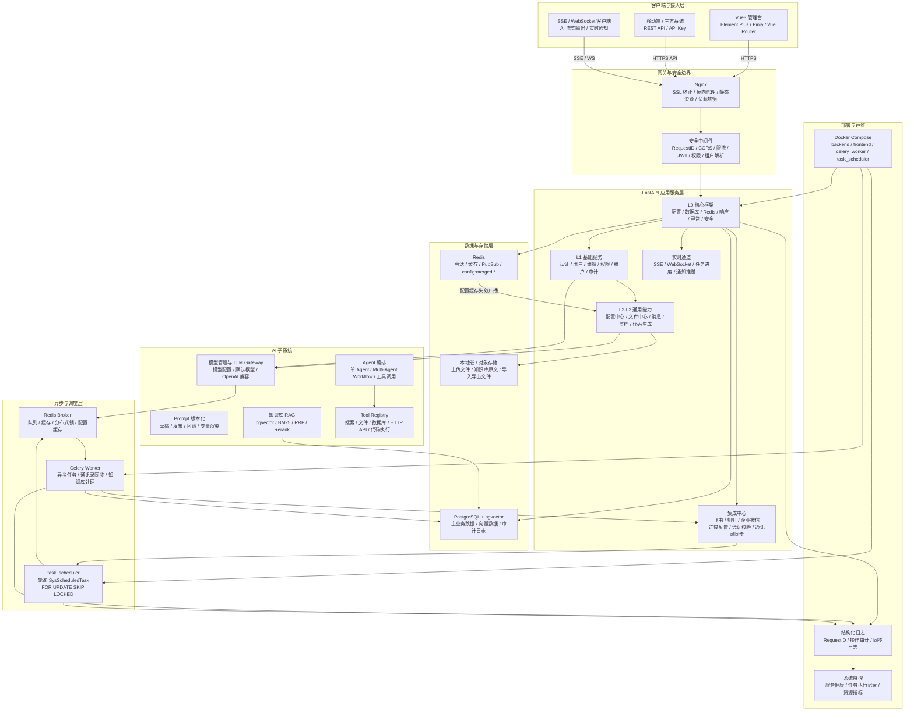

# 01 架构总览

> **阅读对象**：想深入了解若茗底座架构设计的开发者。  
> 如果你是第一次接触若茗，建议先读 [00_产品介绍.md](./00_产品介绍.md) 和 [02_核心概念.md](./02_核心概念.md)。

## 1. 项目定位

若茗 PaaS 是一套**面向开发者的企业级 AI 应用开发底座**。

**定位**：帮助开发团队跳过重复造基础设施的阶段，直接在一个生产可用的底座上开发业务功能。

**核心目标**：
- 企业级底座与原生 AI 能力二合一（市面上极少有同时做好两件事的框架）
- 模块化设计，L0-L4 分层，按需启用，新模块插件式接入
- 约定优于配置：遵守规范，底层能力（租户隔离、审计、限流）自动生效
- 生产可用而非玩具：每个设计决策都考虑了生产环境的安全性和稳定性

---

## 2. 技术选型

### 2.1 后端

| 层次 | 技术 | 版本 | 说明 |
|------|------|------|------|
| Web 框架 | FastAPI | ≥ 0.110 | 异步、自动 OpenAPI |
| 数据库 ORM | SQLAlchemy 2.x + Alembic | ≥ 2.0 | 异步 ORM，迁移管理 |
| 主数据库 | PostgreSQL + pgvector | ≥ 16 | 见下方详细说明 |
| 缓存 / 消息 | Redis | ≥ 7.0 | 见下方详细说明 |
| 向量存储 | PostgreSQL + pgvector | — | 知识库向量检索，减少额外运维组件 |
| 任务队列 | Celery + Redis Broker | — | 异步任务、计划任务、知识库处理、外部联系人同步 |
| 认证 | JWT (**PyJWT**) | ≥ 2.8 | Access + Refresh Token，Rotation 轮换策略 |
| 数据验证 | Pydantic v2 | ≥ 2.0 | 请求/响应模型 |
| 日志 | **structlog**（主）+ Loguru（文件 sink） | — | 结构化 JSON 日志，单一数据流 |
| 链路追踪 | OpenTelemetry | — | Trace/Span 注入 |
| AI SDK | LangChain（内部封装，不对外暴露） | ≥ 0.2 | Agent 编排底层 |
| 大模型接入 | 追鹿 API + OpenAI 兼容层 | — | 统一 LLM 网关 |
| 文件存储 | MinIO / 阿里云 OSS | — | 对象存储（含签名下载权限） |
| 限流 | slowapi + Redis | — | 按用户/租户/IP/接口多维限流 |
| 全文检索 | PostgreSQL FTS（内置）/ Elasticsearch（可选） | — | 知识库 BM25 检索，ES 可选接入 |

---

### 2.2 数据库选型说明

#### 主数据库：PostgreSQL 16 + pgvector

选择 PostgreSQL 而非 MySQL，核心原因如下：

| 能力 | PostgreSQL | MySQL | 对若茗的意义 |
|------|-----------|-------|------------|
| **JSONB 原生支持** | ✅ 可索引、可查询 | ⚠️ JSON 支持弱 | 配置中心四级覆盖值、审计日志变更快照直接存 JSONB，无需额外序列化 |
| **行级安全（RLS）** | ✅ 原生支持 | ❌ 不支持 | 多租户数据隔离的最后一道兜底防线，应用层出 bug 时数据库层防止越权 |
| **pgvector 插件** | ✅ 直接安装 | ❌ 不支持 | MVP 阶段向量检索不需要单独部署 Milvus/Qdrant，减少基础设施复杂度 |
| **全文检索（FTS）** | ✅ 内置 `tsvector`，中文分词可扩展 | ⚠️ 较弱 | BM25 检索直接用 PG 内置，无需引入 ES |
| **窗口函数 / CTE** | ✅ 完整支持 | ⚠️ 部分支持 | 审计日志查询、报表 BI、分页统计场景必备 |
| **事务完整性** | ✅ MVCC 成熟，写并发强 | ⚠️ 有差距 | 多租户高并发写入场景更可靠 |
| **扩展生态** | pgvector、TimescaleDB、PostGIS… | 极少 | 未来时序数据、地理信息等场景可无缝扩展 |

> **为什么不用 MySQL**：MySQL 不支持 RLS（多租户兜底防护失效）、不支持 pgvector（必须额外部署向量库）、JSONB 能力弱（配置中心和审计日志设计受限）。三个核心缺口对若茗 PaaS 而言不可接受。

#### 缓存层：Redis 7+

Redis 在若茗中承担多个角色，选择 Redis 7+ 原因：

| 使用场景 | 说明 |
|---------|------|
| **会话缓存** | JWT Refresh Token 存储与黑名单（Token 撤销） |
| **接口限流** | slowapi 依赖 Redis 计数器，支持滑动窗口算法 |
| **任务队列** | Celery Broker / Result Backend，承载异步任务分发与结果存储 |
| **Pub/Sub** | 事件总线跨进程事件广播，WebSocket 多实例消息同步，配置缓存失效广播 |
| **分布式锁** | 防止计划任务重复执行、并发导入冲突 |
| **热点数据缓存** | 权限树、字典数据、`config:merged:*` 合并配置等高频读取数据 |
| **AI Token 配额** | 实时累计每租户的 LLM Token 消耗，超配额立即熔断 |

> **Redis 7+ 的关键新特性**：Multi-Part AOF（持久化可靠性提升）、ACL 细粒度权限控制（多租户环境更安全）、Functions（替代部分 Lua 脚本场景）。

#### 向量数据库：分阶段策略

若茗对向量数据库采用**分阶段演进**策略，而非一开始就引入重型向量库：

```
MVP 阶段（< 百万向量）
  └── pgvector（PostgreSQL 插件）
        优点：零额外部署、与主库事务一致、运维成本低
        适用：知识库文档量不大、团队人力有限时

生产扩展阶段（> 百万向量 或 高并发检索）
  └── Milvus（自建）/ Qdrant（轻量自建）/ Zilliz Cloud（托管）
        优点：专为向量检索优化、支持十亿级向量、ANN 性能远超 PG
        迁移成本：RAGService 封装了向量库接口，切换只需改 adapter
```

> **接口封装原则**：`KnowledgeBaseService` 通过 `VectorStoreAdapter` 抽象层访问向量库，切换底层向量库不需要修改业务代码，只需替换 adapter 实现。

### 2.3 前端

| 层次 | 技术 | 版本 | 说明 |
|------|------|------|------|
| 框架 | Vue 3 | ≥ 3.4 | Composition API |
| UI 库 | Element Plus | ≥ 2.7 | 企业级组件 |
| 状态管理 | Pinia | ≥ 2.1 | 轻量状态 |
| 路由 | Vue Router 4 | — | 动态路由 |
| HTTP 客户端 | Axios + 封装层 | — | 拦截器、Token 自动刷新 |
| 构建工具 | Vite 5 | — | 快速构建 |
| 类型 | TypeScript | ≥ 5.0 | 全量类型安全 |
| 代码风格 | ESLint + Prettier | — | — |
| 图表 | ECharts 5 | — | 数据可视化 |
| 富文本 | WangEditor 5 | — | 编辑器 |
| 低代码表单 | form-render / 自研 | — | JSON Schema 驱动表单 |

### 2.4 基础设施

| 组件 | 技术 |
|------|------|
| 容器化 | Docker + Docker Compose |
| 本地编排 | `backend` / `frontend` / `celery_worker` / `task_scheduler` / PostgreSQL / Redis |
| 反向代理 | Nginx |
| CI/CD | GitHub Actions / Gitea Actions |
| 任务调度 | 独立 `task_scheduler` 轮询计划任务，Celery Worker 执行异步任务 |
| 日志 | 结构化日志 + 操作审计 + 计划任务执行记录 + 联系人同步日志 |

---

## 3. 系统架构图



---

## 4. 模块列表

> 底座模块按**层次职责**分为 L0-L4，层次越低越不可缺，层次越高越按需启用。  
> 插件注册流水线：`域注册 → 权限 → 菜单 → 字典 → 路由 → 事件 → 迁移 → 就绪`

### 4.1 L0 核心框架（不可禁用）

| 模块 | 说明 |
|------|------|
| `core.app_factory` | FastAPI 应用工厂、生命周期管理 |
| `core.config` | 环境变量加载、Fail-Fast 校验 |
| `core.database` | SQLAlchemy 异步引擎、Session 管理 |
| `core.redis` | Redis 连接池、Pub/Sub 工厂 |
| `core.exceptions` | 类型化异常体系、全局异常处理器 |
| `core.middleware` | RequestID → 日志 → CORS → 限流 → 认证 → 权限 → 租户解析 |
| `core.response` | 统一响应格式 `ApiResponse`、错误码常量 |
| `core.security` | JWT（PyJWT）、密码哈希、Token 轮换 |
| `core.i18n` | 国际化基础（可选，L4 完整启用） |

### 4.2 L1 基础服务（不可禁用）

| 模块 | 说明 | 优先级 |
|------|------|--------|
| `auth` | 登录、JWT、Refresh Token 轮换、API Key 管理、SSO 入口 | P0 |
| `user` | 用户管理、个人资料、登录锁定 | P0 |
| `organization` | 组织/部门管理 | P0 |
| `permission` | 角色继承、权限、菜单（统一到 `sys_permission`），细粒度到按钮列 | P0 |
| `tenant` | 多租户管理、租户注册、配额管理、套餐 | P0 |
| `audit` | 操作日志（含变更前后快照）、登录日志、安全事件日志 | P0 |
| `portal` | 公告、门户工作台（首页入口） | P1 |
| `config_center` | 系统配置，**四级分层**：全局 → 租户 → 应用 → 用户，支持动态下发 | P0 |

### 4.3 L2 通用引擎（可选启用）

| 模块 | 说明 | 优先级 |
|------|------|--------|
| `event_bus` | **事件总线**：持久化事件、重试、死信队列、延迟事件、事件溯源，跨模块解耦基础 | P0 |
| `scheduler` | 任务调度：定时任务、编排、重试、执行日志 | P1 |
| `rate_limit` | 限流（按用户/租户/IP/接口），AI Token 配额限制 | P0 |
| `import_engine` | 数据导入引擎：Excel/CSV、模板映射、校验、错误报告 | P1 |
| `export_engine` | 数据导出引擎：大数据量流式 Excel/CSV（百万行）、导出进度推送 | P1 |
| `search` | 搜索服务：全文检索，PG FTS 内置，ES 可切换 | P1 |
| `workflow` | 工作流引擎：审批流程定义、任务、回退（P1 按需引入） | P1 |
| `state_machine` | 状态机引擎：业务状态流转定义与实例管理 | P2 |

### 4.4 L3 通用模块（可选启用）

| 模块 | 说明 | 优先级 |
|------|------|--------|
| `notification` | 通知中心：站内实时消息（WebSocket）、邮件、短信、钉钉/企微 | P1 |
| `file` | 文件管理：上传、OSS 对接、签名下载权限控制、文件版本 | P1 |
| `dict` | 数据字典 | P1 |
| `monitor` | 系统监控：CPU/内存/任务健康检查、前端错误上报 | P2 |
| `sso` | SSO 集成：OAuth2 / OIDC / 企业微信 / 钉钉 | P1 |
| `cache_framework` | 缓存框架：策略抽象、预热、分布式锁、命中率监控 | P1 |
| `codegen` | 代码生成器：CRUD 脚手架、Model/Schema/API/前端页面/测试用例 | P2 |

### 4.5 L4 高级能力（按需启用）

| 模块 | 说明 |
|------|------|
| `feature_flag` | 灰度发布：Feature Flag、A/B 测试、分流策略 |
| `report_bi` | 报表 BI：设计器、数据大屏、导出 |
| `i18n` | 国际化：多语言、时区、货币 |
| `disaster_recovery` | 灾备：自动备份、恢复验证、跨机房 |
| `compliance` | 数据合规：数据保留策略、导出权、删除权（GDPR） |

### 4.6 AI 能力模块（若茗核心差异化）

| 模块 | 说明 | 优先级 |
|------|------|--------|
| `ai.llm` | LLM 网关、模型管理、追鹿 API + OpenAI 兼容层 | P0 |
| `ai.agent` | 单 Agent 定义、执行、会话管理 | P0 |
| `ai.conversation` | 对话历史、多轮上下文管理 | P0 |
| `ai.knowledge` | 知识库管理、文档解析、向量化、RAG 混合检索 | P1 |
| `ai.tool` | 工具注册、执行沙箱 | P1 |
| `ai.prompt` | Prompt 模板管理与版本化 | P1 |
| `ai.multi_agent` | Multi-Agent 编排、工作流（DAG）定义 | P1 |
| `ai.eval` | 模型评测、Benchmark | P2 |

---

## 5. 核心设计原则

1. **按功能域组织代码**，不按技术层分文件夹
2. **Controller 不含业务逻辑**，只做解析/校验/响应格式化
3. **Service 不感知 HTTP**，可复用于任务/脚本/测试
4. **所有配置从环境变量读取**，启动时 Fail-Fast 校验
5. **所有错误类型化**，全局异常处理器统一响应格式
6. **所有输入在边界校验**，Pydantic 强制验证
7. **结构化 JSON 日志**，携带 RequestID 贯穿全链路
8. **AI 模块插件化**，新模型/工具可热插拔注册；LangChain 封装在内部，不对外暴露
9. **权限元数据前后端同步**，前端路由/按钮由后端权限数据驱动，**安全校验在后端**
10. **数据库操作必须经过 TenantAwareRepository**，自动注入 `tenant_id`，应用层 + 兜底双重防护
11. **日志写入非阻塞**，使用 `asyncio.create_task` 丢入后台，不阻塞接口响应

---

## 6. 安全基线要求

| 安全项 | 实现方式 |
|--------|---------|
| 认证 | JWT（PyJWT）+ Refresh Token 轮换（Rotation） |
| API 密钥 | 数据库存储 + Hash 验证，支持三方系统调用 |
| 登录保护 | 连续失败 5 次锁定账号 30 分钟 |
| 密码 | bcrypt 单向哈希，禁止明文存储 |
| 敏感配置 | API Key / DB 密码 AES-256 加密存储 |
| 文件上传 | MIME + 文件头双重检测，白名单扩展名 |
| SQL 注入 | 全程 SQLAlchemy ORM 参数化，禁止字符串拼接 SQL |
| 限流 | slowapi 按 IP/用户/接口多维限流，防爆破 |
| 跨租户防护 | Repository 层注入 + 兜底拦截双重检查 |
| 操作审计 | 所有写操作记录 before/after 快照，超管代入租户强制审计 |

详见 [11_安全设计.md](./11_安全设计.md)
